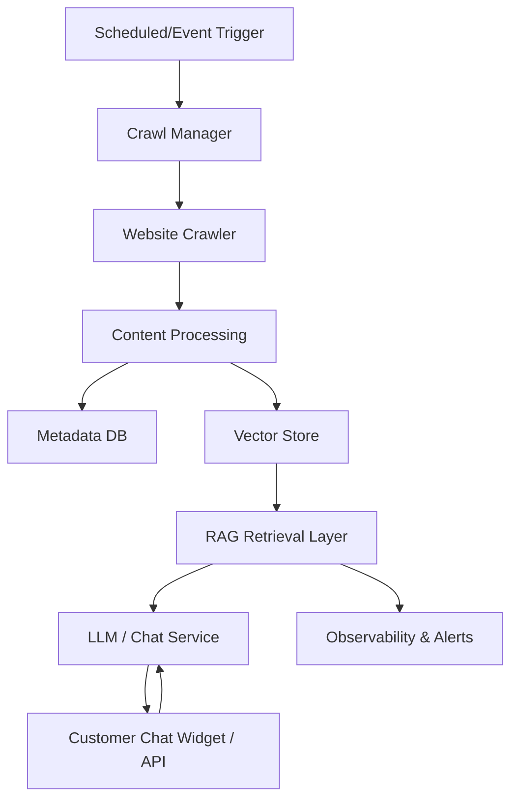

# AI Knowledge System Architecture

## Logical Diagram

## Data Flow
1. **Trigger**: Cron, webhook, or manual URL submission invokes the pipeline.
2. **Crawl**: `WebsiteCrawler` walks public pages within the allowed domains, respecting robots.txt and rate limits.
3. **Processing**: HTML is cleaned, boilerplate is removed, and semantic chunks are generated with metadata (URL, content type, timestamps).
4. **Storage**: Chunks are persisted in SQLite for change detection and in Chroma for vector search. Checksums prevent duplicate embeddings.
5. **Retrieval**: The RAG layer searches embeddings, builds a grounded prompt, and calls the LLM provider.
6. **Chat**: FastAPI endpoint `/chat` serves the chatbot. Frontend widget calls this API and renders answers with source links.
7. **Monitoring**: Logs capture crawl coverage, errors, and data freshness; alerts can be sent via webhook.

## Tech Stack
- **Ingestion**: `requests`, `BeautifulSoup`, `trafilatura` for content extraction.
- **Processing**: Python, `pydantic` settings, heuristic content classification, checksum-based change detection.
- **Storage**: SQLite for metadata; `chromadb` with `sentence-transformers` embeddings for vectors.
- **API**: FastAPI for chatbot and admin hooks; uvicorn for serving.
- **LLM**: Pluggable provider (OpenAI/Azure/local) invoked after prompt building.
- **Ops**: Cron/Cloud Scheduler for refresh; Docker/Kubernetes for deployment; optional Slack webhook for alerts.

## Implementation Steps
1. Configure `AIKB_BASE_URL` and `AIKB_ALLOWED_DOMAINS` in `.env`.
2. Run `python -m src.pipeline` to crawl, clean, chunk, and index the site.
3. Start the chatbot with `uvicorn src.app:app --reload` and integrate the `/chat` endpoint with your widget.
4. Schedule the pipeline (cron/K8s CronJob) and enable webhook-based URL submissions for instant indexing.
5. Wire your LLM provider into `src/rag.py` where indicated and add guardrails (source quoting, refusal policy).
6. Add observability: log crawls, push metrics, and set up alerts for failures or stale content.

## Scalability & Multi-language
- Swap the embedding model for multi-lingual options (e.g., `paraphrase-multilingual-MiniLM-L12-v2`).
- Scale Chroma with a remote server or managed vector DB (Pinecone/Weaviate) for large sites.
- Run multiple crawler workers with a shared queue and depth limits to control load.
- Cache robots.txt decisions and ETag/Last-Modified headers to minimize bandwidth.
